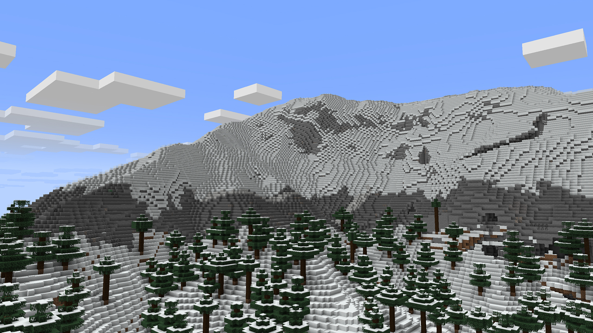

# NovoAtlas

---

---

*A data-driven image based world generator for Minecraft.*

[:curseforge:](https://www.curseforge.com/minecraft/mc-mods/novoatlas)
[:modrinth:](https://modrinth.com/mod/novoatlas)
[:github:](https://github.com/TheDeathlyCow/novoatlas)
[:book:](https://novoatlas.thedeathlycow.com)

---

NovoAtlas is a mod that allows you to paint a world's height map and biome map, and then import that to a datapack and allow the Minecraft world generator to fill in the rest of the details. It is a fork of the original [Atlas](https://modrinth.com/mod/atlas), made with their permission under its CC0 license. I made a few contributions to Atlas, but I felt that the changes I wanted to make were substantial enough to warrant a fork. I have used NovoAtlas on my own SMP server, which has been a good real-world testing environment for it as well.

Improvements over the original Atlas include NeoForge support, improved structure-terrain blending, improved underwater cave generation, cave biome maps, image wrapping, and blend-to-random image generation (allows you to blend the finite image-based world to a normal infinite Minecraft world).

## LTS Policy

Currently, NovoAtlas only supports the latest version of Minecraft that the mod has released on. Ports to newer versions will be made as quickly as possible, but know that I am just one person and will not always have time to do this immediately. If you are looking for this mod on 1.19 and 1.20, you can get them from the original Atlas mod at: https://modrinth.com/mod/atlas

Quick version support reference:

| Minecraft Version | Support Status                                         |
| ----------------- | ------------------------------------------------------ |
| 26.3.x            | :white_check_mark: Supported                           |
| 26.2.x            | :warning: Available                                    |
| 26.1.x            | :warning: Available                                    |
| 1.21.11           | :warning: Available                                    |
| 1.21.9-10         | :warning: Available                                    |
| 1.21.6-8          | :warning: Available                                    |
| 1.21.5            | :warning: Available                                    |
| 1.21.4            | :warning: Available                                    |
| 1.21.2-3          | :warning: Available (Fabric only)                      |
| 1.21.1            | :warning: Available                                    |
| 1.20.5-6          | :x: Unsupported                                        |
| 1.20.3-4          | :x: Unsupported                                        |
| 1.20.2            | :x: Unsupported                                        |
| 1.20-1.20.1       | :warning: Available[^1]                                |
| 1.19.4            | :x: Unsupported                                        |
| 1.19.3            | :warning: Available (Original Atlas Mod only)          |
| 1.19-1.19.2       | :warning: Available (Original Atlas Mod only)          |
| 1.18.x and older  | :x: Unsupported                                        |

---

[^1]: I do not have time or capacity to develop new features or fix issues for 1.20.1 myself; this version is only supported by community contribution. If you want a feature or fix backported, please submit a PR on GitHub (or create a fork). You can also get 1.20.1 versions of the original Atlas mod.
